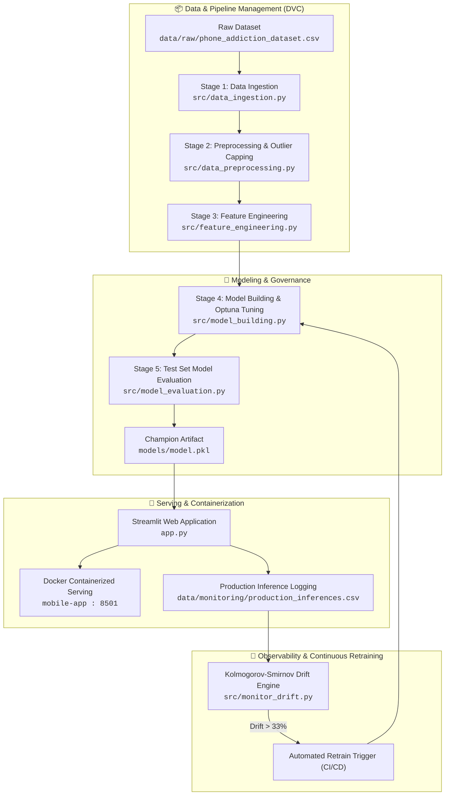

# 📱 Mobile Usage Addiction Prediction — Production MLOps Platform

[](https://github.com/haribonaboina/mobile-addiction-mlops/actions/workflows/main.yaml)
[](https://www.python.org/)
[](https://dvc.org/)
[](https://mlflow.org/)
[](https://www.docker.com/)
[](https://streamlit.io/)
[](https://docs.pytest.org/)
[](LICENSE)

An end-to-end, production-grade Machine Learning Operations (MLOps) system designed to predict and monitor smartphone addiction risk levels. Built using data versioning with **DVC**, experiment tracking via **MLflow**, automated hyperparameter optimization with **Optuna**, multi-criteria champion selection, containerization via **Docker**, statistical **Kolmogorov-Smirnov data drift monitoring**, and automated **GitHub Actions CI/CD**.

---

## 🚀 Key Performance Highlights

| Metric | Champion Value | Industry Standard | Status |
| :--- | :---: | :---: | :---: |
| **Champion Model** | **Gradient Boosting Regressor** | Top Candidate | Selected |
| **Test $R^2$ Score** | **0.9959 (99.59%)** | $> 0.85$ | Exceptional |
| **Mean Absolute Error (MAE)** | **0.0483** | $< 0.20$ | Exceptional |
| **Root Mean Squared Error (RMSE)** | **0.1051** | $< 0.30$ | Exceptional |
| **Accuracy within $\pm 1$ point** | **100.0%** | $> 95\%$ | Perfect |
| **Overfitting Gap ($R^2_{\text{train}} - R^2_{\text{val}}$)** | **0.93 pp** | $< 5.0\text{ pp}$ | Fully Generalized |
| **Single-Row Prediction Latency** | **~88.9 ms** | $< 200\text{ ms}$ | Production Ready |

---

## 🏗️ End-to-End MLOps Architecture



---

## 🏆 Multi-Criteria Model Selection & Leaderboard

Candidate algorithms are benchmarked across 5-fold cross-validation and evaluated using an automated, penalty-weighted governance policy configured in `params.yaml`.

### Benchmark Leaderboard

| Model Candidate | Validation $R^2$ (%) | Training $R^2$ (%) | Overfitting Gap (pp) | Model Size (MB) | Train Time (s) | Predict Latency (ms) | Status |
| :--- | :---: | :---: | :---: | :---: | :---: | :---: | :---: |
| **Gradient Boosting** | **99.05%** | **99.98%** | **0.93 pp** | **2.79 MB** | **11.20 s** | **88.98 ms** | 🏆 **CHAMPION** |
| Random Forest | 96.89% | 98.89% | 2.00 pp | 13.12 MB | 3.13 s | 3482.37 ms | Eligible Finalist |
| Linear Regression | 78.39% | 78.80% | 0.41 pp | 0.002 MB | 0.03 s | 86.95 ms | Eligible Baseline |
| Decision Tree | 88.66% | 94.98% | 6.31 pp | 0.06 MB | 0.01 s | 77.39 ms | Disqualified (Gap $> 5.0\text{pp}$) |

### Governance Selection Rules:
1. **Overfitting Gap Filter**: The generalization gap $(R^2_{\text{train}} - R^2_{\text{val}})$ must be strictly $< 5.0\text{ percentage points}$.
2. **Performance Tolerance**: Candidates within $1.0\text{ pp}$ of the highest validation $R^2$ qualify as finalists.
3. **Multi-Objective Cost Minimization**: Finalists are ranked using a weighted objective:
   $$\text{Cost} = 0.40 \times \text{Size}_{\text{normalized}} + 0.30 \times \text{FitTime}_{\text{normalized}} + 0.30 \times \text{Latency}_{\text{normalized}}$$

---

## 🧠 Engineered Domain Features

Domain-specific interactions and psychological behavioral signals were engineered in `src/feature_engineering.py`:

| Feature Name | Formulation | Behavioral Rationale |
| :--- | :--- | :--- |
| `weekend_minus_daily` | $\text{Weekend Usage} - \text{Daily Usage}$ | Measures loss of routine and surge in unstructured screen time. |
| `usage_per_check` | $\frac{\text{Daily Usage Hours} \times 60}{\text{Phone Checks Per Day}}$ | Differentiates quick utilitarian glances from prolonged rabbit-hole sessions. |
| `checks_per_hour` | $\frac{\text{Phone Checks Per Day}}{\text{Daily Usage Hours}}$ | Quantifies compulsive phone-checking frequency per hour. |
| `social_gaming_total` | $\text{Time on Social Media} + \text{Time on Gaming}$ | Sum of high-dopamine leisure activities. |
| `leisure_share` | $\frac{\text{Social} + \text{Gaming}}{\text{Daily Usage Hours}}$ | Proportion of total screen time allocated to entertainment vs utility. |
| `productive_share` | $\frac{\text{Time on Education}}{\text{Daily Usage Hours}}$ | Mitigating factor measuring constructive device engagement. |
| `apps_x_usage` | $\text{Apps Used Daily} \times \text{Daily Usage Hours}$ | Interaction intensity metric combining app switching frequency and total hours. |
| `usage_sleep_ratio` | $\frac{\text{Daily Usage Hours}}{\text{Sleep Hours}}$ | Screen time vs physiological rest deficit ratio. |
| `bedtime_share` | $\frac{\text{Screen Time Before Bed}}{\text{Daily Usage Hours}}$ | Exposure to blue light immediately preceding sleep. |

---

## 🔬 Data Drift Monitoring (KS Statistical Testing)

Production inferences are monitored in real time using the **two-sample Kolmogorov-Smirnov (KS) test** ($\alpha = 0.05$):
- **Baseline Distribution**: Derived from training baseline splits.
- **Production Distribution**: Collected dynamically from inference requests.
- **Automatic Retraining Decision Gate**: Continuous retraining is triggered in CI/CD when $> 33\%$ of monitored features exhibit statistically significant distribution drift.
- **Reports Generated**:
  - Interactive HTML Dashboard: `reports/drift_report.html`
  - Markdown Alert: `reports/drift_alert.md`
  - Structured Metadata: `reports/drift_report.json`

---

## 🖥️ Streamlit Web Application

The interactive web dashboard (`app.py`) provides 4 dedicated modules:
1. **🎯 Real-Time Individual Prediction**: Interactive sliders and inputs that generate addiction risk predictions, confidence scores, and personalized behavioral feedback.
2. **📁 Batch CSV Predictions**: Upload CSV datasets, run vectorized champion inference, and export predictions with confidence metadata.
3. **📊 Model Performance & MLflow Diagnostics**: Live inspection of evaluation metrics, cross-validation $R^2$, and model comparison leaderboards.
4. **🔬 Statistical Data Drift Dashboard**: Live KS-test statistics, $p$-values, baseline vs production distributions, and drift alerting.

---

## 📂 Project Repository Structure

```text
mobile-usage-predictor/
├── .github/
│   └── workflows/
│       ├── main.yaml                   # CI/CD: DVC pipeline, Pytest, Docker build & smoke test
│       └── scheduled_drift_retrain.yaml # Scheduled statistical drift check & retraining trigger
├── .streamlit/
│   └── config.toml                     # Clean Streamlit production theme & headless server config
├── data/
│   ├── raw/                            # Immutable raw dataset (phone_addiction_dataset.csv)
│   ├── ingested/                       # Standardized cleaned dataset
│   ├── processed/                      # Preprocessed, capped, & engineered feature splits
│   └── monitoring/                     # Production inference logs for drift detection
├── models/
│   └── model.pkl                       # Serialized Champion model (GradientBoosting)
├── reports/
│   ├── metrics.json                    # Automated DVC test metrics
│   ├── model_comparison.md             # Markdown leaderboard generated by pipeline
│   ├── model_comparison.csv            # Structured benchmark data
│   ├── model_selection.json            # Decision metadata and selection audit log
│   ├── drift_report.html               # Interactive visual drift report
│   └── drift_alert.md                  # CI/CD step summary drift alert
├── src/
│   ├── data_ingestion.py               # Stage 1: Validation, schema enforcement, clean ingestion
│   ├── data_preprocessing.py           # Stage 2: Robust IQR outlier capping, stratified split
│   ├── feature_engineering.py          # Stage 3: Domain feature extraction & StandardScaler
│   ├── model_building.py               # Stage 4: 5-fold CV, Optuna tuning, champion selection
│   ├── model_evaluation.py             # Stage 5: Unbiased test set evaluation & metric persistence
│   └── monitor_drift.py                # Kolmogorov-Smirnov two-sample statistical test engine
├── tests/
│   ├── test_data.py                    # Input validation & schema integrity tests
│   ├── test_model.py                   # Model serialization, accuracy, & latency benchmarks
│   ├── test_monitoring.py              # Statistical drift engine unit tests
│   └── test_inference_profiles.py      # Edge case & synthetic behavioral profile tests
├── app.py                              # Production Streamlit serving application
├── Dockerfile                          # Multi-stage container definition with healthchecks
├── dvc.yaml                            # 5-stage DVC pipeline specification
├── dvc.lock                            # Immutable dependency and output hash lockfile
├── params.yaml                         # Centralized hyperparameter and governance configuration
├── requirements.txt                    # Lightweight runtime dependencies for Docker & Streamlit
├── requirements-dvc.txt                # Full training, DVC, Optuna, and testing dependencies
└── README.md                           # Project documentation
```

---

## ⚡ Quick Start Guide

### 1. Local Setup
```powershell
# Clone the repository
git clone https://github.com/haribonaboina/mobile-addiction-mlops.git
cd mobile-addiction-mlops

# Create and activate virtual environment
python -m venv myenv
.\myenv\Scripts\activate

# Install dependencies
pip install -r requirements-dvc.txt
```

### 2. Reproduce the DVC Pipeline
```powershell
# Reproduce all 5 stages end-to-end
dvc repro

# View pipeline execution DAG
dvc dag

# View latest model metrics
dvc metrics show
```

### 3. Run Automated Tests
```powershell
pytest tests/ -v
```

### 4. Run the Streamlit Application
```powershell
streamlit run app.py
```
Open **[http://localhost:8501](http://localhost:8501)** in your browser.

---

## 🐳 Docker Deployment

The application is containerized with a lightweight Python 3.11 image and an integrated healthcheck:

```powershell
# Build the Docker image
docker build -t mobile-addiction-predictor:latest .

# Run the container with port 8501 mapped
docker run -d -p 8501:8501 --name mobile-app mobile-addiction-predictor:latest

# Verify health status
docker ps
```
The app will be instantly accessible at **[http://localhost:8501](http://localhost:8501)**.

---

## 🔄 Automated CI/CD Workflows

This project utilizes GitHub Actions for continuous integration, quality gates, and automated deployment:

1. **`main.yaml` (Build, Test, & Smoke Test)**:
   - Triggers on every `push` and `pull_request` to `main`.
   - Re-executes the DVC pipeline and verifies reproducibility.
   - Runs all 13 `pytest` unit and integration tests.
   - Enforces strict quality gates ($R^2 \ge 0.85$, Overfitting Gap $< 5.0\text{ pp}$).
   - Builds the Docker image and executes a container smoke test (`http://localhost:8501/_stcore/health`).
2. **`scheduled_drift_retrain.yaml` (Continuous Monitoring)**:
   - Performs automated statistical drift checks on production inference traffic.
   - Triggers automatic pipeline reproduction and retraining when feature distribution drift is detected.

---

## 📄 License
This project is licensed under the [MIT License](LICENSE).
