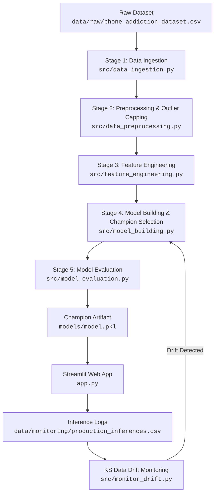

# 📱 Mobile Usage Addiction Prediction - Production MLOps System

An end-to-end production-grade Machine Learning Operations (MLOps) architecture for predicting smartphone addiction risk levels based on user usage habits, behavioral metrics, and sleep interactions.

---

## 🏗️ Architecture Overview



---

## 🎯 Pipeline Stages (`dvc.yaml`)

| Stage | Command | Inputs | Outputs |
|---|---|---|---|
| `data_ingestion` | `python src/data_ingestion.py` | `data/raw/phone_addiction_dataset.csv` | `data/ingested/phone_addiction.csv` |
| `data_preprocessing` | `python src/data_preprocessing.py` | `data/ingested/phone_addiction.csv`, `params.yaml` | `data/processed/train.csv`, `test.csv` |
| `feature_engineering` | `python src/feature_engineering.py` | `data/processed/train.csv`, `test.csv` | `data/processed/X_train.csv`, `X_test.csv`, `y_train.csv`, `y_test.csv` |
| `model_building` | `python src/model_building.py` | `X_train.csv`, `y_train.csv`, `params.yaml` | `models/model.pkl`, candidate models, `reports/model_selection.json`, `reports/model_comparison.csv` |
| `model_evaluation` | `python src/model_evaluation.py` | `models/`, `X_test.csv`, `y_test.csv` | `reports/metrics.json`, `reports/evaluation_details.json` |

---

## 🧠 Engineered Domain Features

1. `weekend_minus_daily`: Weekend vs weekday usage difference.
2. `usage_per_check`: Average duration per phone check.
3. `checks_per_hour`: Screen check frequency per hour of usage.
4. `social_gaming_total`: Combined entertainment screentime.
5. `leisure_share`: Ratio of social/gaming screentime to total usage.
6. `productive_share`: Ratio of educational screentime to total usage.
7. `apps_x_usage`: Multiplicative intensity interaction between app variety and daily hours.
8. `usage_sleep_ratio`: Screen time vs sleep duration ratio.
9. `bedtime_share`: Proportion of screentime spent right before sleep.

---

## 🏆 Multi-Criteria Champion Selection Policy

In `params.yaml`, the champion is determined automatically across candidate regressors (`LinearRegression`, `DecisionTree`, `RandomForest`, `GradientBoosting`) through 4 strict rules:
1. **Overfitting Gap Filter**: The validation vs training gap $(R^2_{\text{train}} - R^2_{\text{val}})$ must be strictly $< 5.0\text{ pp}$.
2. **Performance Tolerance**: Candidates within $1.0\text{ pp}$ of the highest validation $R^2$ qualify as finalists.
3. **Multi-Criteria Penalty**: Finalists are ranked using a weighted combination of:
   - Model File Size ($40\%$ weight)
   - Training Fit Duration ($30\%$ weight)
   - Single-Row Prediction Latency ($30\%$ weight)

---

## 🔬 Data Drift Monitoring (`src/monitor_drift.py`)

- Uses the **Kolmogorov-Smirnov (KS) two-sample statistical test** ($p < 0.05$).
- Tracks production inference payloads in `data/monitoring/production_inferences.csv`.
- Generates HTML dashboards (`reports/drift_report.html`) and CI alert summaries (`reports/drift_alert.md`).
- Triggers automatic continuous retraining when $> 33\%$ of features experience statistical drift.

---

## 🚀 Running the System Locally

### 1. Initialize Pipeline
```powershell
dvc repro
```

### 2. Run Tests
```powershell
pytest tests/ -v
```

### 3. Launch Serving Dashboard
```powershell
streamlit run app.py
```

### 4. Check Data Drift
```powershell
python src/monitor_drift.py --generate-sample-data
```
